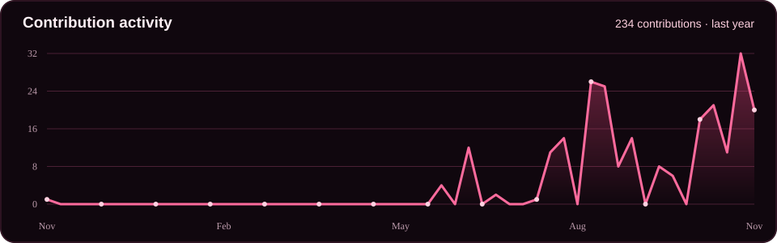
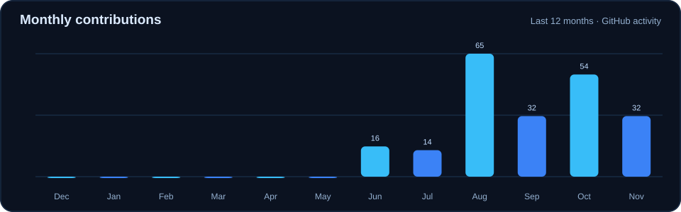

  

  

  

    
    
    
    
  

  

## 👋 About

  

## 🧩 Selected Projects

Project source code is private. These links open live demos or project stories.

[RescueMesh project story ↗](https://portfolio-two-rho-ay000oc54o.vercel.app/case-studies/rescuemesh.html) · [VD-MockBot live demo ↗](https://vd-mockbot.vercel.app) · [VD-EventHub live demo ↗](https://vd-eventhub-9wnp.vercel.app) · [VD-Trio live demo ↗](https://vd-trio-5ms7.onrender.com) · [VD-Collect live demo ↗](https://vd-collect.vercel.app) · [Aegis AI Firewall ↗](https://vikas-daddi.github.io/aegis-ai-firewall/) · [Zipify Tools ↗](https://zipify-tools.vercel.app) · [AI Candidate Ranker demo](mailto:vikki74111@gmail.com?subject=AI%20Candidate%20Ranker%20demo)

## 🧑‍💻 Experience & Achievement

**MERN Stack Web Development Intern · CodeLab Systems** 
*February–May 2026 · Mangaluru, India*

Built VD-EventHub as the internship capstone, including event booking, QR ticket generation and check-in, role-based access, and an admin analytics dashboard.

**Top 25 of ~400 teams · Code Cubicle 6.0** 
Solo participant in the Geek Room hackathon; the final round was held at Paytm, Noida.

## 🛠️ Tools I Use

  

  <strong>AI &amp; Data:</strong> Ollama · Groq · Whisper · OCR · Data Analysis · Data Visualization 
  <strong>Systems:</strong> ESP32 · LoRa · GPS · Ionic Capacitor

## 📊 GitHub Activity

  
  

## 🐍 Contribution Animation

  <picture>
    <source media="(prefers-color-scheme: dark)" srcset="https://raw.githubusercontent.com/Vikas-daddi/Vikas-daddi/output/github-contribution-grid-snake-dark.svg" />
    <source media="(prefers-color-scheme: light)" srcset="https://raw.githubusercontent.com/Vikas-daddi/Vikas-daddi/output/github-contribution-grid-snake.svg" />
    
  </picture>

  Thanks for stopping by. Explore the demos and project stories on my <a href="https://portfolio-two-rho-ay000oc54o.vercel.app/">portfolio ↗</a>.

